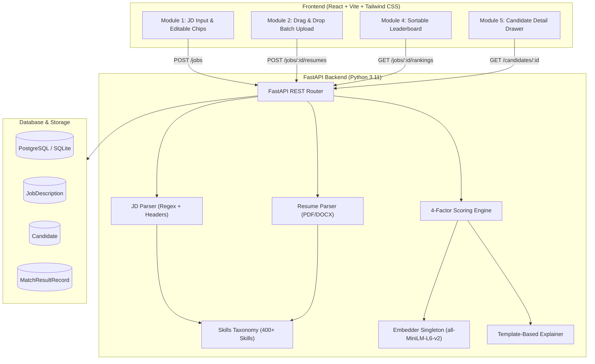

# TalentRank AI — Resume Matching & Ranking System

[](https://github.com/prashantgupta2109/talent-rank-ai/actions)
[](https://fastapi.tiangolo.com)
[](https://react.dev)
[](https://www.python.org/)
[](https://opensource.org/licenses/MIT)

> An enterprise-grade, explainable AI platform that parses job descriptions, processes batch resumes (PDF & DOCX), performs hybrid semantic matching, and ranks candidates on an interactive recruiter dashboard.

---

## 1. Project Overview

Recruiting teams spend hours manually screening resumes against dense job requirements. Traditional keyword-based Applicant Tracking Systems (ATS) suffer from two major flaws:
1. **False negatives**: A candidate with *"PostgreSQL"* might be rejected because the job strictly requested *"SQL"*.
2. **Keyword stuffing**: Candidates who repeat buzzwords without context receive artificially inflated scores.

This system combines **deterministic entity extraction** (`spaCy` + a 400+ skill taxonomy) with **dense semantic embeddings** (`sentence-transformers/all-MiniLM-L6-v2`) and **chronological interval merging** to calculate a calibrated **0–100 match score** accompanied by **plain-English justifications**.

---

## 2. Features Mapped to Modules

| Module | Assignment Requirement | Implementation |
|---|---|---|
| **Module 1: Job Description Input** | Paste or upload JD; extract key requirements, skills, experience, and qualifications. | Textarea + file upload, regex section segmenter (`Requirements`, `Nice to have`, `Responsibilities`), deterministic extraction, and **interactive editable skill chips** before saving. |
| **Module 2: Resume Upload** | Batch upload $\ge 10$ resumes in PDF and DOCX formats; extract candidate details. | Concurrent multi-file uploader (`asyncio` + `ThreadPoolExecutor`), PDF table parsing via `pdfplumber`, DOCX parsing via `python-docx`, non-overlapping experience interval merging. |
| **Module 3: AI Resume Matching** | Semantic similarity + keyword matching; calculate 0–100 score; matched & missing skills. | 4-factor scoring algorithm: Skills ($40\%$), Semantic ($30\%$), Experience ($20\%$), Education ($10\%$). Embedding cosine similarity threshold ($\ge 0.75$) for semantic skill equivalents. |
| **Module 4: Candidate Ranking Dashboard** | Sortable table: Candidate, Experience, Match %, Matched Skills. | Sortable leaderboard table with rank medals (🥇, 🥈, 🥉), colored progress bars, matched skill chips, live search, and CSV export. |
| **Module 5: Candidate-Level Analysis** | Recruiter drawer: extracted profile, overall score, matched/missing skills, experience comparison, score reasons. | Slide-over drawer with circular score gauge, 4-factor breakdown chart, green matched chips, red missing chips, surplus/deficit experience analysis, and top semantic evidence quotes. |

### Value-Add Extras
- **Live Weight Sliders**: Recruiter can dynamically tweak factor weights (e.g. increase Experience to 40%) and watch rankings re-sort in real time.
- **Blind Screening Toggle**: One-click anonymization masking candidate names and contact details to reduce unconscious hiring bias.
- **Side-by-Side Comparison**: Select any two candidates to compare their metrics, skill coverage, and experience side by side.
- **Instant Demo Dataset**: Includes 12 realistic fictional resumes (6 PDF, 6 DOCX) spanning Strong, Medium, and Weak fits.

---

## 3. System Architecture



---

## 4. Matching Algorithm & Scoring Methodology

The overall score is a weighted linear combination of four normalized components ($0 \to 100$):

$$\text{Final Score} = 0.40 \times S_{\text{skills}} + 0.30 \times S_{\text{semantic}} + 0.20 \times S_{\text{experience}} + 0.10 \times S_{\text{education}}$$

Weights and thresholds are defined centrally in `backend/app/config.py`:

```python
WEIGHT_SKILLS = 0.40
WEIGHT_SEMANTIC = 0.30
WEIGHT_EXPERIENCE = 0.20
WEIGHT_EDUCATION = 0.10
SKILL_SIMILARITY_THRESHOLD = 0.75
```

### Component Formulations

#### 1. Skill Score ($S_{\text{skills}}$, Weight = 40%)
- Skills are extracted from the JD and partitioned into **Required** (weight $1.0$) and **Preferred** (weight $0.5$).
- A JD skill counts as satisfied if:
  1. It appears verbatim/canonically in candidate skills, **OR**
  2. Its embedding cosine similarity to any resume skill is $\ge 0.75$ (e.g. candidate skill *"PostgreSQL"* satisfies JD skill *"SQL"*).
- Calculation:
  $$S_{\text{skills}} = \frac{\sum \text{Earned Weights}}{\sum \text{Total Possible Weights}} \times 100$$

#### 2. Semantic Score ($S_{\text{semantic}}$, Weight = 30%)
- JD duty sentences and resume paragraph chunks are encoded with `all-MiniLM-L6-v2`.
- For each JD duty sentence $i$, compute the maximum cosine similarity across all candidate resume chunks:
  $$M_i = \max_j \left(\cos(\mathbf{q}_i, \mathbf{c}_j)\right)$$
- The raw average $\bar{M} = \frac{1}{N}\sum_{i=1}^N M_i$ typically spans $[0.20, 0.80]$. It is clamped and rescaled to $[0, 100]$:
  $$S_{\text{semantic}} = \text{clamp}\left(\frac{\bar{M} - 0.20}{0.80 - 0.20} \times 100, 0, 100\right)$$

#### 3. Experience Score ($S_{\text{experience}}$, Weight = 20%)
- Employment intervals from the resume are parsed and **merged across overlaps** to prevent double-counting parallel jobs.
- Score scales linearly up to the requirement, plus a $+10\%$ title bonus for target keyword matches:
  $$S_{\text{experience}} = \min\left(\frac{\text{Candidate Years}}{\text{Required Years}}, 1.0\right) \times 100 + \text{Title Bonus}$$

#### 4. Education Score ($S_{\text{education}}$, Weight = 10%)
- Degree hierarchy baseline: $\text{Ph.D.} = 100$, $\text{Master's} = 90$, $\text{Bachelor's} = 80$, $\text{Associate} = 65$, $\text{None} = 40$.
- STEM specialization bonus: $+10$ points if the major is Computer Science, Data Science, Software Engineering, or Mathematics (capped at $100$).

---

### Worked Scoring Example: Dr. Alex Mercer (Strong Fit)

Target Job: **Senior Python / Machine Learning Engineer** (4.0 years exp, Bachelor's in CS, Required: Python, PyTorch, FastAPI, Docker, PostgreSQL; Preferred: AWS, Kubernetes).

1. **Skills ($S_{\text{skills}}$)**:
   - Required skills (weight 1.0 each): Python (✓), PyTorch (✓), FastAPI (✓), Docker (✓), PostgreSQL (✓) $\to 5.0 / 5.0$.
   - Preferred skills (weight 0.5 each): AWS (✓), Kubernetes (✓) $\to 1.0 / 1.0$.
   - Total weight earned: $6.0 / 6.0 = 1.0$.
   - **$S_{\text{skills}} = 100.0$**

2. **Semantic ($S_{\text{semantic}}$)**:
   - Average max cosine similarity across duty sentences $\bar{M} = 0.74$.
   - Rescaled: $\frac{0.74 - 0.20}{0.80 - 0.20} \times 100 = \frac{0.54}{0.60} \times 100 = 90.0$.
   - **$S_{\text{semantic}} = 90.0$**

3. **Experience ($S_{\text{experience}}$)**:
   - Merged date intervals: 2018–2020 (2.8 yrs) + 2021–Present (3.2 yrs) = 6.0 non-overlapping years.
   - Requirement: 4.0 years $\to \min(6.0 / 4.0, 1.0) = 1.0 \times 100 = 100.0$.
   - Past title: "Lead Machine Learning Engineer" matches target title keywords $\to$ capped at 100.
   - **$S_{\text{experience}} = 100.0$**

4. **Education ($S_{\text{education}}$)**:
   - Highest degree: Ph.D. in Computer Science $\to$ Base 100.0 + STEM bonus $\to$ capped at 100.
   - **$S_{\text{education}} = 100.0$**

5. **Composite Calculation**:
   $$\text{Final Score} = (0.40 \times 100.0) + (0.30 \times 90.0) + (0.20 \times 100.0) + (0.10 \times 100.0)$$
   $$\text{Final Score} = 40.0 + 27.0 + 20.0 + 10.0 = \mathbf{97.0\%}$$

---

## 5. Technology Stack Decisions

| Layer | Choice | Why Chosen |
|---|---|---|
| **Frontend** | React 18, Vite, Tailwind CSS | Fast compilation, modern component architecture, responsive recruiter dashboard. |
| **Backend** | Python 3.11, FastAPI | Asynchronous I/O, strict typing, auto-generated OpenAPI documentation (`/docs`). |
| **NLP & Vectors** | `sentence-transformers` (`all-MiniLM-L6-v2`) + `spaCy` | Lightweight, fast CPU inference, zero API cost, completely offline/private. |
| **Document Parsing** | `pdfplumber`, `python-docx` | Layout-aware text extraction from complex multi-column resumes and table structures. |
| **Database** | PostgreSQL via SQLAlchemy 2.0 | Production-grade relational storage with JSON support; SQLite fallback for standalone runs. |
| **Packaging** | Docker Compose | Instant single-command build and spin-up for recruiters. |

---

## 6. Setup & Execution Guide

### Option A: One-Command Docker Compose (Recommended)

Make sure [Docker Desktop](https://www.docker.com/) is installed and running:

```bash
docker compose up --build
```

- Frontend: `http://localhost:5173`
- Backend API Docs: `http://localhost:8000/docs`
- Healthcheck: `http://localhost:8000/health`

---

### Option B: Local Manual Setup

#### 1. Backend Setup
```bash
cd backend
python -m venv venv

# Windows
.\venv\Scripts\activate
# macOS/Linux
source venv/bin/activate

pip install -r requirements.txt
python -m spacy download en_core_web_sm

# Start FastAPI server
uvicorn app.main:app --host 0.0.0.0 --port 8000 --reload
```

#### 2. Frontend Setup
```bash
cd frontend
npm install
npm run dev
```
Open `http://localhost:5173` in your browser.

---

### Option C: Deploy the Backend on Render

1. Commit and push the backend fix in `backend/app/services/scorer.py` (it imports `Optional`, used by `calculate_match`). The reported Render deployment used commit `f83261c`, which does not include that fix.
2. In Render, create a **Web Service** connected to this repository and select **Docker** as the runtime.
3. Set **Root Directory** to `backend`. Render will use `backend/Dockerfile` and `backend/requirements.txt`.
4. Set the health check path to `/health`. The Dockerfile listens on Render's `PORT` environment variable.
5. For persistent production data, create a Render PostgreSQL database and set the web service's `DATABASE_URL` to that database's **Internal Database URL**. Without it, the app uses a local SQLite file, which is not persistent on Render's default filesystem.
6. If the frontend is hosted separately, set `CORS_ORIGINS` to a JSON array containing its origin, for example `["https://your-frontend.onrender.com"]`.

After saving the settings, deploy the latest commit. Verify the service at `https://<your-service>.onrender.com/health`; API docs are available at `/docs`.

---

## 7. API Reference Summary

| Method | Endpoint | Description |
|---|---|---|
| `GET` | `/health` | Service health status, UTC timestamp, and version. |
| `POST` | `/jobs/` | Parse and persist a new Job Description. |
| `GET` | `/jobs/` | List all saved job descriptions. |
| `POST` | `/jobs/:id/resumes` | Multipart batch upload of $\ge 10$ resumes (PDF/DOCX) with concurrent parsing. |
| `POST` | `/jobs/:id/match` | Execute 4-factor matching algorithm across candidates and persist results. |
| `GET` | `/jobs/:id/rankings` | Module 4 Candidate Leaderboard sorted by score. |
| `GET` | `/candidates/:id` | Module 5 Candidate-Level deep dive (scores, reasons, matched/missing skills). |

---

## 8. Test Suite

Run the automated test suite with pytest:

```bash
cd backend
pytest tests/ -v
```

Tests verify:
- Contact and education regex extraction.
- Non-overlapping experience interval merging (handling parallel jobs).
- Skill scoring with exact match and embedding similarity thresholds.
- Rescaled cosine semantic matching.
- Strong vs. Weak candidate scoring discrimination.
- Template-based explainability generation without LLMs.

---

## 9. Limitations & Future Work

1. **Scanned PDF Resumes**: Resumes submitted as scanned bitmap images require an optical character recognition (OCR) engine like `Tesseract` or `easyocr`.
2. **Cross-Encoder Reranking**: Incorporating a lightweight cross-encoder (e.g. `cross-encoder/ms-marco-MiniLM-L-6-v2`) on top candidates can further sharpen semantic distinction on subtle domain nuances.
3. **Multi-Language Support**: Expanding the taxonomy and embeddings to multilingual models (`paraphrase-multilingual-MiniLM-L12-v2`) for global hiring teams.
